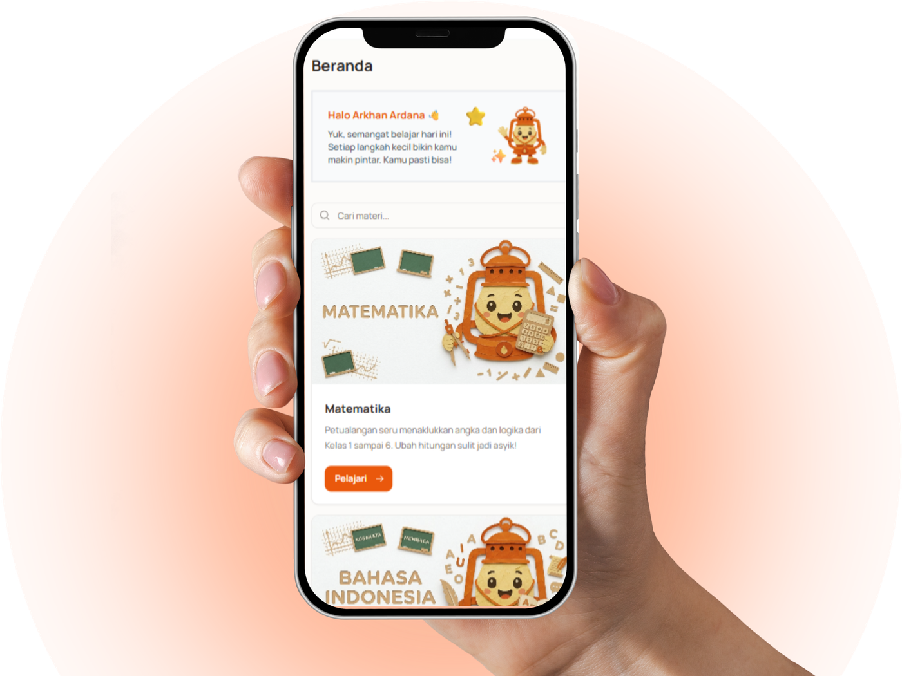
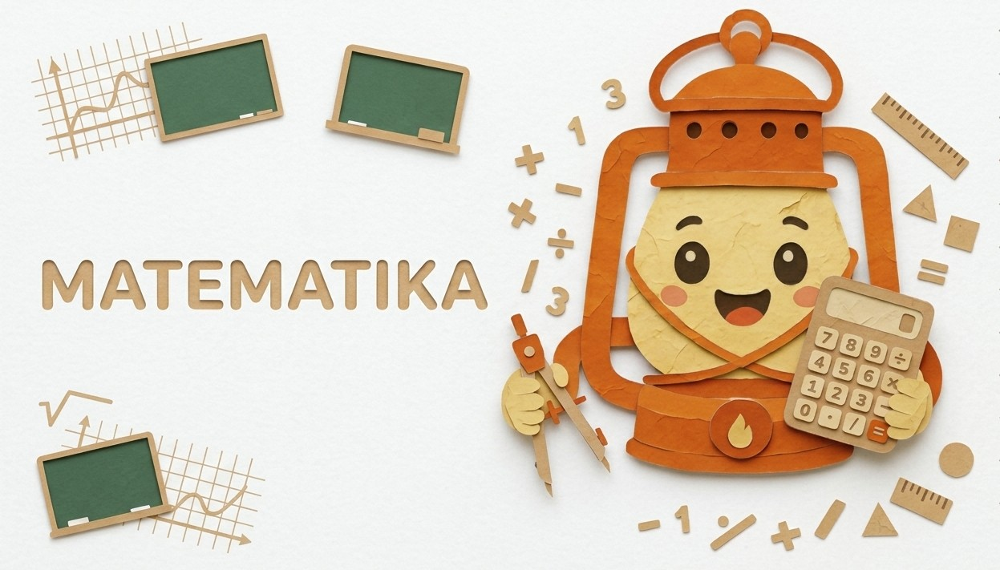
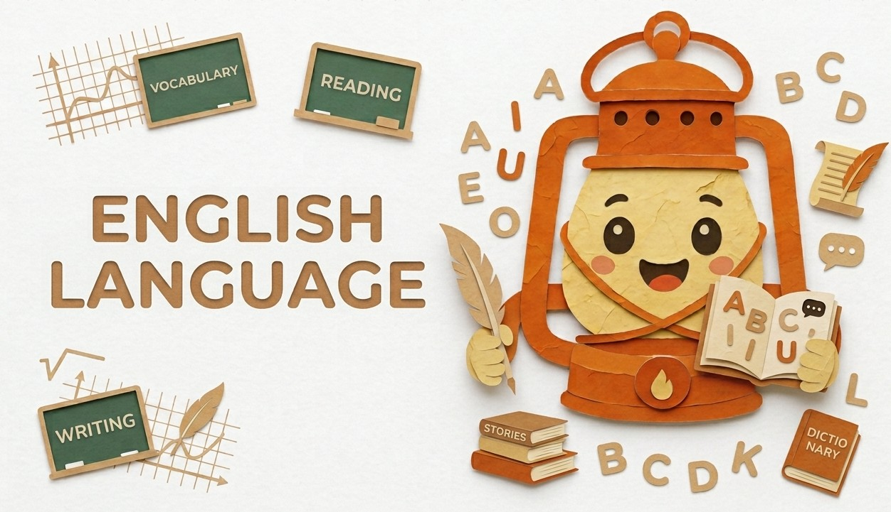

  
   
  

<h1 align="center">Lentera</h1>

  <strong>Platform Edukasi Inklusif & Interaktif untuk Siswa Sekolah Dasar di Indonesia</strong> 
  <em>Belajar mandiri di rumah dengan seru, terarah, adaptif, dan ramah untuk semua anak.</em>

  
  
  
  

  

---

## 📌 Daftar Isi
1. [Tentang Lentera (Overview)](#-tentang-lentera-overview)
2. [Fitur Unggulan](#-fitur-unggulan)
3. [Panduan Penggunaan untuk Siswa (Anak)](#-panduan-penggunaan-untuk-siswa-anak)
   - [Alur Belajar Mandiri](#alur-belajar-mandiri)
   - [Langkah Demi Langkah Belajar di Lentera](#langkah-demi-langkah-belajar-di-lentera)
   - [Mengenal Jenis Aktivitas Pembelajaran](#mengenal-jenis-aktivitas-pembelajaran)
   - [Menyalakan Api Belajar (Streak)](#menyalakan-api-belajar-streak)
   - [Membagikan Kode Pairing ke Orang Tua](#membagikan-kode-pairing-ke-orang-tua)
4. [Panduan Penggunaan untuk Orang Tua](#-panduan-penggunaan-untuk-orang-tua)
   - [Alur Monitoring Perkembangan Anak](#alur-monitoring-perkembangan-anak)
   - [Langkah Demi Langkah Menggunakan Parent Dashboard](#langkah-demi-langkah-menggunakan-parent-dashboard)
   - [Informasi & Metrik yang Dapat Dipantau](#informasi--metrik-yang-dapat-dipantau)
5. [Tanya Jawab Seputar Penggunaan (FAQ)](#-tanya-jawab-seputar-penggunaan-faq)

---

## 🌟 Tentang Lentera (Overview)

**Lentera** adalah platform belajar daring interaktif yang dirancang khusus untuk mendampingi anak-anak usia Sekolah Dasar (SD) di Indonesia dalam belajar mandiri di rumah secara menyenangkan, terarah, dan tidak membosankan.

Lentera dikembangkan dengan prinsip **inklusivitas**, menjadikannya ramah bagi seluruh anak termasuk mereka yang membutuhkan metode penyampaian adaptif (seperti fitur audio narasi otomatis). Melalui pendekatan **jalur belajar bertingkat (learning path)** dan sistem **Streak Api Belajar**, Lentera menumbuhkan kebiasaan positif belajar setiap hari, sementara orang tua diberikan sarana transparan untuk memantau tumbuh kembang belajar buah hati mereka.

### Nilai Utama Lentera
- **✨ Inklusif & Ramah Anak**: Dilengkapi fitur *Dengarkan Teks* (*Text-to-Speech*) berbahasa Indonesia dan antarmuka visual ceria yang mudah dipahami anak.
- **🎮 Petualangan Belajar Menyenangkan**: Pembelajaran dirancang seperti level permainan. Level berikutnya terbuka seiring materi dituntaskan.
- **🔥 Konsistensi Lewat Gamifikasi**: Sistem Streak Api Belajar yang menyala setiap hari anak aktif belajar, lengkap dengan animasi selebrasi pop-up dan konfeti gembira.
- **🤝 Kemitraan dengan Orang Tua**: Dashboard monitoring sederhana yang menghubungkan anak dan orang tua melalui kode pairing tanpa registrasi rumit.

---

## 🎯 Fitur Unggulan

### 👦 Ruang Belajar Anak (Siswa)
| Fitur | Manfaat untuk Anak |
|---|---|
| 🗺️ **Peta Jalur Belajar (*Learning Path*)** | Mengetahui urutan belajar dari level awal hingga mahir secara terstruktur. |
| 📖 **Materi Multi-Format** | Belajar melalui bacaan interaktif, audio narasi (*Text-to-Speech*), dan video edukatif. |
| 🧩 **Latihan Soal Interaktif** | Berlatih dengan Pilihan Ganda, Benar/Salah, Isian Singkat, hingga Drag-and-Drop. |
| ⚡ **Cek Otomatis & Coba Lagi** | Jawaban langsung dievaluasi seketika. Jika salah, anak dapat mencoba lagi tanpa rasa takut. |
| 🔥 **Streak Api Belajar Harian** | Menjaga semangat belajar harian dengan animasi api belajar dan pop-up pencapaian. |
| 🔑 **Kode Pairing Mandiri** | Kode 6-karakter untuk disambungkan ke akun orang tua kapan saja. |

### 👨‍👩‍👧 Dashboard Pendampingan Orang Tua (Parent)
| Fitur | Manfaat untuk Orang Tua |
|---|---|
| 📊 **Dasbor Terpusat** | Memantau seluruh anak yang terhubung dalam satu layar yang rapi dan mudah dibaca. |
| 🔗 **Koneksi Cepat (Pairing Code)** | Cukup ketikkan kode 6-digit dari anak untuk langsung terhubung seketika. |
| 📈 **Persentase Capaian Belajar** | Melihat tingkat kelulusan materi pada mata pelajaran Matematika, Bahasa Indonesia, dan Bahasa Inggris. |
| 📅 **Status Api Belajar Harian** | Mengetahui secara langsung apakah anak sudah belajar hari ini atau belum. |
| 📝 **Riwayat Aktivitas Terakhir** | Melihat materi, video, atau kuis apa yang baru saja diselesaikan oleh anak. |

---

## 🎒 Panduan Penggunaan untuk Siswa (Anak)

### 🗺️ Alur Belajar Siswa (4 Tahap Petualangan)

<table width="100%">
  <tr>
    <td align="center" width="22%">
        
      <strong>🚀 Masuk & Pilih Kelas</strong>  
      <small>Pilih jenjang kelas (1–6 SD) dan mata pelajaran yang ingin dipelajari.</small>
    </td>
    <td align="center" width="4%">➡️</td>
    <td align="center" width="22%">
        
      <strong>🗺️ Jalur Belajar</strong>  
      <small>Buka peta petualangan. Level baru terbuka otomatis setelah materi tuntas.</small>
    </td>
    <td align="center" width="4%">➡️</td>
    <td align="center" width="22%">
        
      <strong>📖 Eksplorasi Materi</strong>  
      <small>Baca teks dengan audio suara <b>Dengarkan Teks 🔊</b> atau tonton video.</small>
    </td>
    <td align="center" width="4%">➡️</td>
    <td align="center" width="22%">
        
      <strong>🔥 Kuis & Api Belajar</strong>  
      <small>Jawab latihan (Pilgan/Drag-Drop), otomatis selesai, dan rayakan Streak!</small>
    </td>
  </tr>
</table>

 

#### 🎯 Panduan Alur Setiap Jenis Aktivitas:
| Jenis Aktivitas | Apa yang Dilakukan Siswa? | Kelanjutan / Hasil |
|---|---|---|
| 📖 **Materi Teks** | Baca teks atau klik **"Dengarkan Teks"** untuk narasi audio otomatis. | Klik **Tandai Selesai** ➔ Materi berikutnya terbuka 🔓 |
| 🎬 **Materi Video** | Tonton video edukatif & pelajari rangkuman ringkas di bawahnya. | Klik **Tandai Selesai** ➔ Materi berikutnya terbuka 🔓 |
| 🧩 **Kuis & Latihan** | Jawab kuis (Pilihan Ganda, Isian, atau Susun Kartu Drag-and-Drop). | • **Benar:** Otomatis selesai & Api Belajar menyala 🔥 • **Salah:** Klik **Coba Lagi** untuk mengulang bebas 🔄 |

---

### Langkah Demi Langkah Belajar di Lentera

#### 1. Masuk ke Akun
- Akses aplikasi Lentera di browser Anda.
- Klik **Masuk** di pojok kanan atas atau tombol **Coba Gratis**.
- Masuk menggunakan email terdaftar atau akun Google Anda.
- Pilih peran **Anak** untuk membuka beranda belajar siswa.

#### 2. Memilih Mata Pelajaran & Kelas
Di halaman beranda siswa, Anda dapat memilih mata pelajaran yang ingin dipelajari:

|  **Matematika** |  **Bahasa Indonesia** |  **Bahasa Inggris** |
|:---:|:---:|:---:|
| Bilangan, hitungan, geometri & logika angka | Membaca, menulis, menyimak & tata bahasa | Kosakata sehari-hari & percakapan dasar |

Pilih tingkat kelas yang sesuai (**Kelas 1 sampai Kelas 6 SD**).

#### 3. Menjelajahi Jalur Belajar (*Learning Path*)
- Setiap mata pelajaran memiliki peta level bertingkat.
- Level pertama akan terbuka secara otomatis. Selesaikan setiap materi di level tersebut agar level berikutnya dapat dibuka.
- Klik pada lingkaran atau kartu materi yang aktif untuk mulai belajar.

---

### Mengenal Jenis Aktivitas Pembelajaran

#### 📖 A. Materi Teks Interaktif & Fitur Suara
- Baca materi dengan teks yang jelas dan ilustrasi menarik.
- **Fitur Ramah Anak (Text-to-Speech)**: Klik tombol **"Dengarkan Teks"** berikon suara. Komputer/ponsel Anda akan membacakan teks pelajaran secara otomatis dalam bahasa Indonesia yang ramah dan jelas.
- Klik tombol **"Tandai Selesai"** setelah selesai membaca untuk mencatat progres Anda.

#### 🎬 B. Materi Video Edukatif
- Tonton video penjelasan materi yang disajikan secara visual.
- Simak poin-poin rangkuman penting yang tercantum di bawah video.
- Klik tombol **"Tandai Selesai"** untuk melanjutkan ke materi selanjutnya.

#### 🧩 C. Latihan Soal & Kuis
Lentera memiliki berbagai tipe latihan interaktif yang menyenangkan:

1. **Pilihan Ganda & Benar/Salah**:
   - Klik pada opsi jawaban yang menurut Anda benar.
   - Pilihan Anda akan langsung diperiksa. Pada soal latihan, jika jawaban Anda benar, materi akan **otomatis tertandai selesai**!
2. **Isian Singkat**:
   - Ketikkan jawaban atau angka pada kolom yang disediakan.
   - Klik tombol **"Periksa Jawaban"**.
3. **Tantangan Drag & Drop (Mengurutkan & Mengelompokkan)**:
   - **Susun Angka/Urutan**: Geser dan letakkan kartu dari yang terkecil ke terbesar (atau sebaliknya).
   - **Kelompokkan Kategori**: Seret kartu ke kotak kelompok yang sesuai (misal: memilah benda padat dan cair).
   - Klik **"Periksa Jawaban"** setelah selesai menyusun.
4. **Tombol "Coba Lagi"**:
   - Jika jawaban Anda belum tepat, jangan berkecil hati! Tombol **"Coba Lagi"** akan muncul agar Anda dapat mencoba kembali hingga paham.

---

### Menyalakan Api Belajar (Streak)

Konsistensi adalah kunci keberhasilan belajar! Lentera memiliki fitur **Streak Api Belajar**:

  
  &nbsp;&nbsp;&nbsp;&nbsp;&nbsp;&nbsp;➡️&nbsp;&nbsp;&nbsp;&nbsp;&nbsp;&nbsp;
  
   
  <small><em>Ikon Api Belajar: Kiri (Belum belajar hari ini) &bull; Kanan (Api menyala terang setelah belajar hari ini)</em></small>

- **Kapan Api Belajar Menyala?**: Setiap kali Anda menyelesaikan minimal **1 aktivitas belajar** (membaca materi, menonton video, atau menjawab latihan) di hari tersebut.
- **Apa yang Terjadi Saat Api Bertambah?**:
  - Akan muncul **pop-up dialog selebrasi** dengan animasi api yang berkobar gembira.
  - Hujan **konfeti warna-warni** merayakan pencapaian harian Anda.
  - Angka hari pada ikon api di navigasi atas akan bertambah (+1 hari).
- **Pertahankan Api Belajar**: Belajarlah setiap hari secara rutin agar api belajar Anda tidak padam!

---

### Membagikan Kode Pairing ke Orang Tua

Agar ayah dan ibu bisa melihat betapa hebatnya progres belajar Anda:
1. Buka halaman **Profil** Anda atau lihat kartu info di Beranda Anak.
2. Anda akan melihat **Kode Pairing** unik berisi 6 karakter (contoh: `LN-7K2P`).
3. Bagikan kode tersebut kepada orang tua Anda untuk dimasukkan ke akun mereka.

---

## 👨‍👩‍👧 Panduan Penggunaan untuk Orang Tua

### 👨‍👩‍👧 Alur Monitoring Perkembangan Anak

<table width="100%">
  <tr>
    <td align="center" width="30%">
        
      <strong>👨‍👩‍👧 Masuk Dashboard</strong>  
      <small>Masuk dan pilih peran <b>Orang Tua</b> untuk membuka ruang kendali pendampingan.</small>
    </td>
    <td align="center" width="5%">➡️</td>
    <td align="center" width="30%">
        
      <strong>🔗 Sambungkan Anak</strong>  
      <small>Klik <b>"Hubungkan Anak"</b> lalu masukkan <b>6-digit kode pairing</b> dari akun anak.</small>
    </td>
    <td align="center" width="5%">➡️</td>
    <td align="center" width="30%">
        
      <strong>📊 Pantau Perkembangan</strong>  
      <small>Pantau api streak belajar harian, progres kurikulum, dan riwayat materi terkini.</small>
    </td>
  </tr>
</table>

 

#### 🔍 Alur Interaksi Berdasarkan Status Anak di Dashboard:
| Kondisi Akun | Langkah yang Dilakukan Orang Tua | Tampilan & Hasil di Dashboard |
|---|---|---|
| **Belum Terhubung** | 1. Minta 6-digit kode pairing dari profil anak. 2. Klik tombol **"Hubungkan Anak"** di dasbor. 3. Ketikkan kode unik (misal: `LN-7K2P`) lalu klik **Hubungkan**. | 🎉 **Akun Terhubung Seketika!** Kartu profil anak langsung ditambahkan ke dasbor dengan foto, nama, dan kelas. |
| **Sudah Terhubung** | Pilih kartu anak yang ingin dilihat untuk memantau progres harian. | 📊 **Data Belajar Lengkap:** • 🔥 **Status Api Belajar:** Cek apakah anak sudah belajar hari ini. • 📈 **Progres Mata Pelajaran:** Persentase kelulusan materi SD. • 📖 **Materi Terakhir:** Pantau latihan & materi yang baru dituntaskan. |

---

### Langkah Demi Langkah Menggunakan Parent Dashboard

#### 1. Masuk sebagai Orang Tua
- Buka aplikasi Lentera dan masuk menggunakan akun Anda.
- Pilih peran **Orang Tua**. Sistem akan mengarahkan Anda ke **Parent Dashboard**.

#### 2. Menghubungkan Akun Anak (*Pairing*)
- Di halaman utama dasbor orang tua, klik tombol **"Hubungkan Anak"** di bagian atas.
- Minta **6-digit kode pairing** yang tertera di akun anak Anda.
- Ketikkan kode tersebut ke dalam kolom dialog, lalu klik **"Hubungkan"**.
- Seketika kartu profil anak akan muncul di dasbor Anda.
- *Catatan: Anda dapat menghubungkan lebih dari satu anak dalam satu akun orang tua.*

#### 3. Memantau Aktivitas Harian Anak
Di dalam kartu setiap anak, Anda dapat memantau:

<table width="100%">
  <thead>
    <tr style="background: #F1F5F9;">
      <th colspan="3" align="left" style="padding: 14px 16px;">
        <table width="100%" style="margin: 0; background: transparent; border: none;">
          <tr>
            <td width="50" style="border: none; padding: 0;">
              
            </td>
            <td style="border: none; padding-left: 10px;">
              Budi Pratama 
              <small style="color: #64748B;">Siswa SD &bull; Kelas 3 SD</small>
            </td>
            <td align="right" style="border: none; padding: 0;">
              
            </td>
          </tr>
        </table>
      </th>
    </tr>
  </thead>
  <tbody>
    <tr>
      <td width="30%">📐 <b>Matematika</b></td>
      <td width="50%">
        <code>[██████████░░░░░░]</code>
      </td>
      <td width="20%" align="right"><b style="color: #2563EB;">62% Selesai</b></td>
    </tr>
    <tr>
      <td>📖 <b>Bahasa Indonesia</b></td>
      <td>
        <code>[██████████████░░]</code>
      </td>
      <td align="right"><b style="color: #059669;">85% Selesai</b></td>
    </tr>
    <tr>
      <td>🌏 <b>Bahasa Inggris</b></td>
      <td>
        <code>[██████░░░░░░░░░░]</code>
      </td>
      <td align="right"><b style="color: #7C3AED;">40% Selesai</b></td>
    </tr>
    <tr style="background: #F8FAFC;">
      <td colspan="3" style="padding: 12px 16px;">
        📌 <b>Aktivitas Terakhir:</b> ✅ Menuntaskan <i>Latihan Pecahan Sederhana</i> (Matematika) &nbsp;&bull;&nbsp; Hari Ini 🎉
      </td>
    </tr>
  </tbody>
</table>

---

### Informasi & Metrik yang Dapat Dipantau
1. **Status Api Belajar Harian**: Mengetahui apakah anak sudah meluangkan waktu untuk belajar hari ini tanpa perlu bertanya terus-menerus.
2. **Bilah Progres Mata Pelajaran**: Menunjukkan seberapa jauh anak telah menuntaskan kurikulum per mata pelajaran.
3. **Materi Terakhir**: Membantu orang tua mendiskusikan topik yang baru saja dipelajari anak saat santai bersama di rumah.
4. **Kelola Koneksi**: Anda dapat mengelola tautan akun anak kapan saja dengan mudah.

---

## ❓ Tanya Jawab Seputar Penggunaan (FAQ)

> [!TIP]
> Pertanyaan umum yang sering ditanyakan seputar cara belajar dan fitur aplikasi Lentera.

#### 1. Apakah Lentera bisa digunakan di ponsel (smartphone) dan tablet?
> **Ya.** Lentera didesain responsif sehingga nyaman diakses melalui komputer, laptop, tablet, maupun layar ponsel pintar.

#### 2. Bagaimana cara kerja fitur "Dengarkan Teks"?
> Di setiap halaman materi teks, terdapat tombol bertuliskan **"Dengarkan Teks"**. Saat ditekan, sistem suara pintar akan membacakan isi tulisan dengan pengucapan bahasa Indonesia yang jelas. Fitur ini sangat membantu anak-anak yang sedang belajar membaca atau lebih mudah menyerap materi lewat pendengaran.

#### 3. Apakah kuis akan langsung selesai jika saya menjawab dengan benar?
> **Ya!** Untuk seluruh jenis latihan (Pilihan Ganda, Isian Singkat, maupun Tantangan Drag & Drop), ketika jawaban Anda sudah tepat, sistem akan secara otomatis menandai materi tersebut **Selesai** dan memunculkan efek selebrasi.

#### 4. Bagaimana jika anak salah saat mengerjakan latihan?
> Jangan khawatir! Lentera menerapkan lingkungan belajar ramah kegagalan (*growth mindset*). Ketika jawaban salah, tombol **"Coba Lagi"** akan muncul sehingga anak dapat berpikir kembali dan mengulang pengerjaan tanpa tekanan nilai negatif.

#### 5. Kapan Streak Api Belajar bertambah?
> Api belajar bertambah 1 hari setiap kali anak menuntaskan minimal satu materi atau latihan di hari itu. Jika anak belajar beberapa kali di hari yang sama, api belajar tetap menyala penuh dan streak akan bertambah lagi keesokan harinya jika anak kembali belajar.

#### 6. Di mana anak dapat melihat Kode Pairing miliknya?
> Kode pairing 6-karakter dapat dilihat di menu **Profil** akun anak atau pada kartu informasi di Beranda Siswa. Kode ini siap disalin dan diberikan kepada orang tua.

#### 7. Apakah satu akun orang tua bisa memantau lebih dari satu anak?
> **Bisa.** Orang tua cukup mengeklik tombol **"Hubungkan Anak"** kembali dan memasukkan kode pairing milik anak kedua, ketiga, dan seterusnya.

---

  Dibuat dengan ❤️ untuk generasi penerus bangsa Indonesia. 
  <strong>Lentera — Menyalakan Api Semangat Belajar Setiap Anak.</strong>

